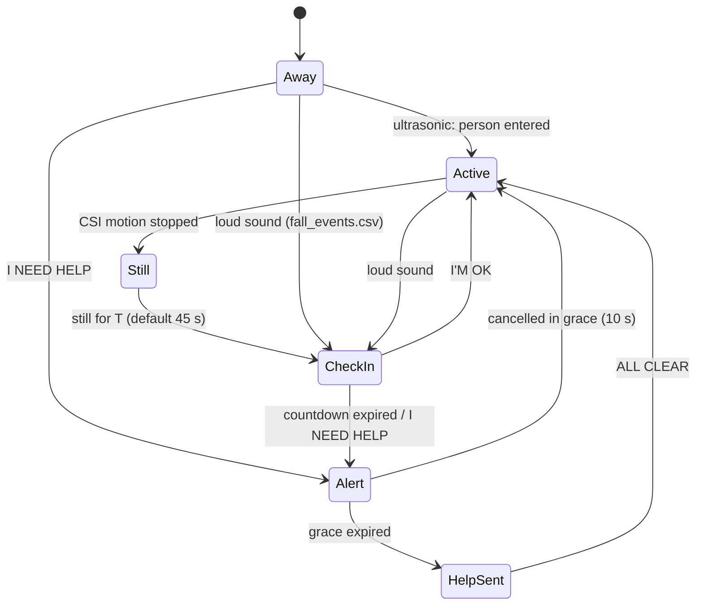

# Touchscreen UI: the room monitor and the "help" flow

The 7" touchscreen (Pi 4B, 800x480) is both the display for what the sensors
see and the interface that escalates when someone may not be able to ask for
help themselves.

> **Research prototype, not a validated safety device.** The help call on
> the HelpSent screen is simulated. Keep it that way unless a real contact
> path (phone integration) is built and tested.

## The idea in one diagram



Why this shape: CSI reliably detects *motion* but cannot tell a still person
from an empty room (docs/LOG.md, session1). So ultrasonic presence gates the
stillness escalation, and sound candidates escalate on their own. Every
escalation has a one-tap cancel, and after any "I'm OK" a 2-minute re-arm
grace prevents repeated false triggers.

## Screens

| Screen | What it shows |
|---|---|
| **Dashboard** | live room map, CSI waterfall + motion line, ultrasonic depths, room noise, activity feed, big I NEED HELP |
| **Check-in** | "ARE YOU OKAY?", why it fired, 30 s countdown arc, voice prompt, I'M OK / I NEED HELP |
| **Alert** | red flashing, loud voice, 10 s last-chance cancel |
| **HelpSent** | simulated call to the trusted contact, staged steps, ALL CLEAR |
| **Settings** | timers, motion factor, voice, contact, calibration, room setup |

## The room map is the actual room

The map is not a drawing of an imaginary room:

1. **Trace it once**: Settings -> Room setup, drag a finger around the walls
   against the 0.5 m grid, tap the door, place and aim each ultrasonic
   sensor, tap where the Pico and Pi sit. Saved to `ui/room.json`.
2. **The sensors draw the rest**: every ultrasonic reading lands a hit point
   at `sensor position + heading x distance`. Points that sit on the
   rolling baseline are structure (walls, furniture); points that deviate
   are hot - that is a person. When two beams deviate, their crossing point
   is marked PERSON.
3. **CSI overlay**: the Pico-Pi sightline pulses while the motion score is
   above threshold; a still-but-present body shifts the static subcarrier
   fingerprint, shown as ROOM STATE CHANGED (the "lying" signature from
   session1, AUC 0.99 on one take pair).

Two fixed sensors alone cannot outline a room from scratch - that is why
the trace supplies the heading diversity and the sensors supply the depth
truth. Adding more HC-SR04s (list them in `ui/settings.json`) thickens the
evidence map automatically.

## Run it

**This Mac, windowed, all sensors simulated:**
```
python3 ui/main.py --csi sim --us sim
```
Demo strip buttons appear: WALK / FALL / IN / OUT drive a simulated person
through the same detection pipeline the real sensors use.

**Replay the recorded session takes (real radio data):**
```
python3 ui/main.py --csi replay --replay data/session1/fall_20261017_000105.pcap
```
TAKE cycles through all takes. With `--speed 2` the take runs faster. The
burst-then-quiet signature of a fall take is visible on the motion strip;
enable presence (IN) and let the stillness clock run to escalate.

**On the Pi, kiosk over the real sensors:**
```
sudo apt install python3-tk espeak-ng libportaudio2
scripts/pi/enable_tcpdump.sh          # once, for live CSI without sudo
scripts/pi/csi_on.sh 11/20 2c:cf:67:c5:c4:14   # once: nexmon CSI mode
scripts/pi/run_ui.sh --csi live
```
If live CSI goes quiet for ~8 s the UI switches itself to replay and says so
on the activity feed - the demo never dead-ends on radio flakiness.

### Calibration (one tap before the demo)

Settings -> **Calibrate empty room** with the room empty: it records 10 s of
the CSI baseline and locks the ultrasonic structure baselines. This matters
because baselines drift between rooms and sessions (docs/LOG.md); a frozen
baseline also stops a person lying in one place from being absorbed into
the rolling median. Presence logic degrades gracefully without it, but
calibrate first whenever the setup moves.

## Voice

Phrases are pre-generated once with the **free Gemini TTS tier**
(`gemini-3.8-flash-lite-tts`, `ui/gemini_tts.py`) and cached as WAVs in
`ui/voice_cache/`, so alert-time playback is instant and needs no network.
Missing or failed phrases fall back to espeak-ng (Pi) or `say` (Mac)
automatically; nothing in the alert path ever blocks on Wi-Fi.

Get a free key at https://aistudio.google.com/apikey, then either:
```
export GEMINI_API_KEY=...        # or put it in ui/settings.json
```
Startup generation is staggered (~one phrase per 15 s) to respect free-tier
rate limits; Settings -> Regenerate voice re-runs it.

### Spoken replies

During the check-in the person can answer out loud: "yes" / "I'm okay"
cancels, "no" / "I need help" goes straight to the alert. `ui/speech.py`
feeds the tail of the rolling mic WAV to an offline Vosk recognizer limited
to those few words (about 2 s latency, since the WAV is republished every
2 s); audio from while the prompt is playing is ignored. Setup:
```
pip install vosk
# unpack vosk-model-small-en-us-0.15 (alphacephei.com/vosk/models) to ui/speech_model/
```
Without vosk or the model it stays off and the buttons work as before.
Only the check-in listens; the red alert still needs the button, so a stray
word can't cancel a real alarm.

## Files

| File | Purpose |
|---|---|
| `ui/main.py` | entry point (`--fullscreen`, `--csi`, `--us`, `--replay`) |
| `ui/app.py` | feeds + tick loop + escalation wiring |
| `ui/escalation.py` | the pure state machine (unit-tested) |
| `ui/screens.py` | Dashboard / CheckIn / Alert / HelpSent / Settings |
| `ui/room_setup.py` | finger-trace room wizard -> `ui/room.json` |
| `ui/room_view.py` | evidence-map canvas |
| `ui/waterfall.py` | CSI heatmap + motion strip |
| `ui/feeds.py` | ultrasonic (gpio/sim), noise level, sound events |
| `src/csi_stream.py` | live tcpdump / replay / sim CSI + motion scoring |
| `ui/voice.py`, `ui/gemini_tts.py` | speech queue, Gemini cache |
| `ui/settings_store.py` | defaults, `ui/settings.json` |
| `scripts/pi/run_ui.sh` | Pi launcher (receiver + detector + kiosk UI) |

Escalations and UI actions append to `ui_events.jsonl` at the repo root -
handy for the Devpost write-up. Tests: `python3 -m pytest tests/` (needs a
display for the UI smoke test).

## Demo playbook

1. Trace the real room (Room setup), or Skip for the default rectangle.
2. **Calibrate empty room** with nobody in the room.
3. Dashboard: walk the judges through the map, the waterfall, the motion
   line - "empty room" visibly sits below threshold.
4. Person walks in: the beams go hot, presence latches, CSI line lifts.
5. Person falls on the mat and lies still: motion drops, the stillness
   clock counts up on the map corner.
6. Check-in fires with the voice prompt; let the countdown run (or press
   I'M OK first to show the dignity-preserving cancel).
7. Alert -> simulated call to the contact -> ALL CLEAR.
8. For the radio story, replay `fall_20261017_000105.pcap` and show the
   burst-then-quiet signature on real recorded data.

## Troubleshooting

- **CSI OFFLINE pill**: live tcpdump saw nothing - was `csi_on.sh` run? The
  UI auto-falls back to replay after ~8 s.
- **Presence won't latch**: deviation needs 30 cm sustained 1.5 s; aim the
  sensors where the person will actually be (bed, chair, doorway), and
  calibrate with the room empty.
- **MIC STALE pill**: `audio_receiver.py` isn't running or the laptop
  sender lost the network (the receiver pads silence - check the sender).
- **Sound events don't appear**: the UI only counts rows appended to
  `fall_events.csv` after it starts, and checks `./`, `/dev/shm/` and
  `sound/` - run the detector as in `run_ui.sh`.
- **Voice is robotic**: no API key set, so the espeak-ng fallback is being
  used; give it a minute after startup for the Gemini cache to fill.
